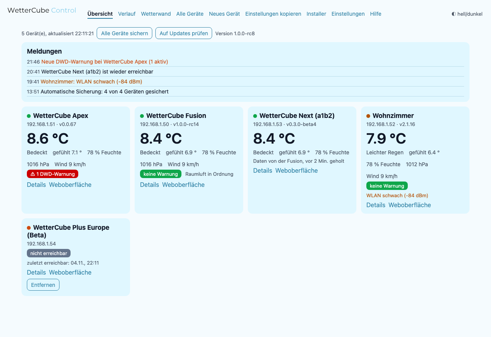
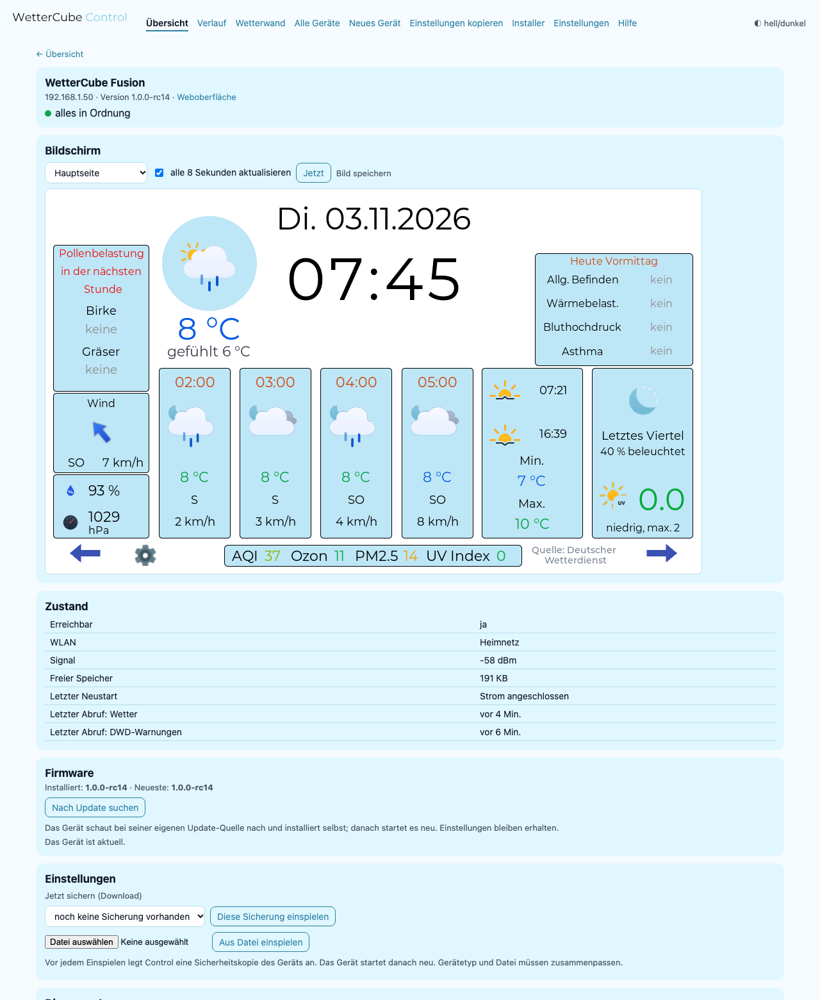
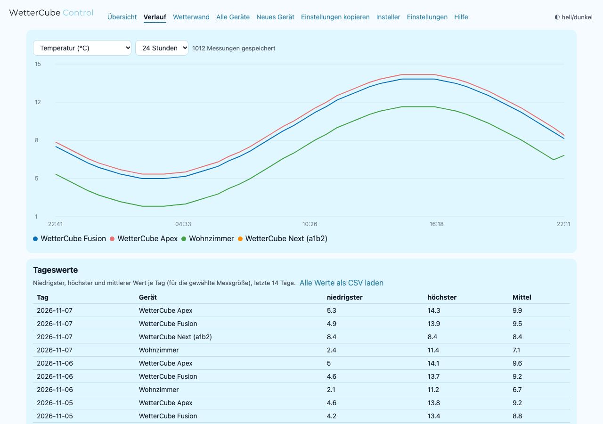
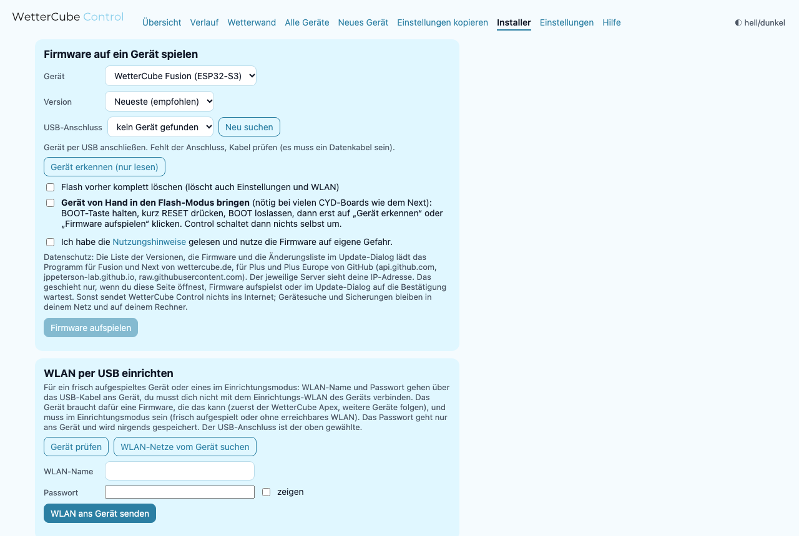
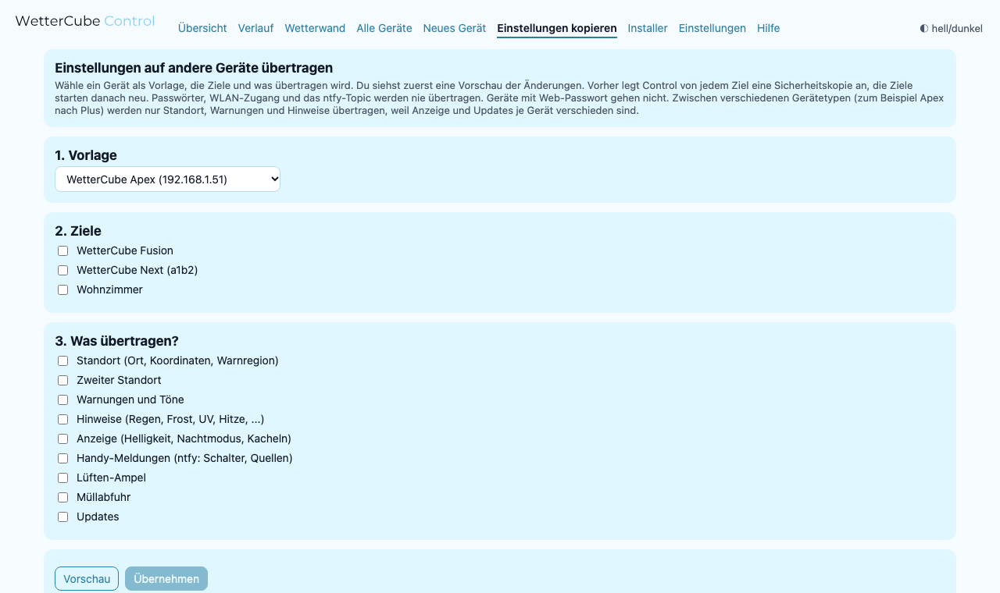

<h1 align="center">
  <picture>
    <source media="(prefers-color-scheme: dark)" srcset="assets/logo/wettercube-control-logo-hell.svg">
    
  </picture>
</h1>

*Version 1.0.0-rc18 (Release Candidate)*

Ein Programm für den Rechner, das alle WetterCube-Geräte im Heimnetz findet und zeigt, überwacht, sichert und flasht.
Mac: `WetterCube Control.app` (Symbol in der Menüleiste), Windows: `WetterCube Control.exe` (Symbol in der Taskleiste), Linux/NAS/Raspberry Pi: Python oder Docker.
Doppelklick genügt: das Symbol erscheint, die Übersicht öffnet sich im Browser (`http://localhost:8765`). Läuft ohne Internet, außer auf der Seite Installer (Versionsliste und Firmware von GitHub).

Video (4:41, YouTube): https://youtu.be/xxPV_vwAXfY · Download und Anleitung: https://wettercube.de/projekte/wettercube-control/ · Wiki: https://wiki.wettercube.de/index.php/Control/Start · Pollenflug, Biowetter und Frost als Webseite: [draussenwetter.de](https://draussenwetter.de/)

## So sieht es aus

<picture><source media="(prefers-color-scheme: dark)" srcset="assets/screens/uebersicht-dunkel.png"></picture> Übersicht: alle Geräte im Heimnetz mit Werten, Warnungen und Zustand (Demo-Daten)

<table>
<tr>
<td width="50%" align="center"><picture><source media="(prefers-color-scheme: dark)" srcset="assets/screens/geraet-dunkel.png"></picture> Gerät: Zustand, Sicherung, Update und Log</td>
<td width="50%" align="center"><picture><source media="(prefers-color-scheme: dark)" srcset="assets/screens/verlauf-dunkel.png"></picture> Verlauf: Kurven und Tageswerte, 90 Tage</td>
</tr>
<tr>
<td width="50%" align="center"><picture><source media="(prefers-color-scheme: dark)" srcset="assets/screens/installer-dunkel.png"></picture> Installer: Firmware per USB aufspielen, auch ältere Versionen</td>
<td width="50%" align="center"><picture><source media="(prefers-color-scheme: dark)" srcset="assets/screens/kopieren-dunkel.png"></picture> Einstellungen kopieren: Vorschau der Änderungen</td>
</tr>
</table>

## Funktionen

| Seite | Was sie kann |
|---|---|
| **Übersicht** | Alle Geräte mit Temperatur, Wetter, Wind, Druck, DWD-Warnung, Gesundheitsampel, „Neu: Version x“; Meldungen |
| **Gerät** (Details) | **Bildschirm live** ansehen und als PNG speichern, Zustand (WLAN, Speicher, Alter der Daten), Einstellungen sichern / **wiederherstellen**, Log mit Filter, **Diagnose-Paket** (ZIP) |
| **Verlauf** | Kurven aller Geräte (Temperatur, Feuchte, Druck, Wind, Luftqualität …), 6 Stunden bis 90 Tage; Tageswerte (niedrigster/höchster/Mittel); CSV-Export; Werte alle 5 Minuten lokal in SQLite |
| **Wetterwand** | Vollbild für Monitor oder Tablet: große Werte, Uhr, Warnband; `?geraete=ip1,ip2`, `?hell=1` |
| **Einstellungen kopieren** | Von einem Gerät auf andere übertragen (Standort, Warnungen, Anzeige, ntfy-Schalter, Lüften, Müll, Updates) mit Vorschau |
| **Installer** | Firmware per USB aufspielen (Fusion S3/P4, Plus, Plus Europe, Next), **auch ältere Versionen** (Rollback), mit Pflicht-Haken „Nutzungshinweise“ |
| **Alle Geräte** | Updates für alle Geräte **nacheinander** (mit Änderungsliste vorher) und eine Einstellung (Helligkeit, Display-Auszeit, Nachtmodus) für mehrere Geräte setzen, mit Vorschau und Sicherheitskopie |
| **Neues Gerät** | Assistent: Firmware aufspielen, WLAN per USB, Gerät finden, Name und Ort, Sicherung |
| **Hilfe** | „Gerät nicht gefunden?“: Schritt-für-Schritt-Prüfung in Klartext, Adresse von Hand prüfen |
| **WLAN per USB** | direkt nach dem Aufspielen WLAN-Name und Passwort über das Kabel ans Gerät senden (Improv Serial), ohne Einrichtungs-WLAN; das Gerät probiert die Verbindung aus und speichert erst bei Erfolg |
| **Einstellungen** | Eigene Namen, Geräte ausblenden, **entfernen** (nicht erreichbare Geräte per Knopf an der Karte, auf Wunsch samt Verlauf, oder automatisch nach einstellbaren Tagen) oder von Hand hinzufügen; Mitteilungen je Art an/aus; **eigene Alarme** (z. B. Frost: Temperatur unter 2 °C); **automatische Sicherung** (täglich/wöchentlich, Tage behalten); **Autostart beim Anmelden** (nur auf Klick) |
| **Updates** | Auf der Geräteseite „Nach Update suchen“ / „Update installieren“ (das Gerät holt und installiert selbst, auch Apex); in der Übersicht „Auf Updates prüfen“ für alle. Control sucht **nie von selbst**; wer will, schaltet in den Einstellungen die stündliche Versionssuche ein (dann „Neu: …“ an der Karte) |
| **Mitteilungen** | Mitteilung am Rechner bei neuer DWD-Warnung, Entwarnung, Gerät offline / wieder da, schwaches WLAN, wenig Speicher, veralteten Daten, neuer Firmware (bei eingeschalteter Versionssuche) |

Schreibende Vorgänge (Wiederherstellen, Kopieren) legen vorher immer eine Sicherheitskopie des Zielgeräts an (`~/WetterCube-Sicherungen/`)
und prüfen den Gerätetyp. Passwörter und WLAN-Zugang sind nie in Sicherungen. Geräte mit Web-Passwort müssen in ihrer eigenen Weboberfläche bedient werden.

## Wichtige Hinweise

- **Nicht signiert.** Die Programme sind nicht von Apple oder Microsoft signiert (das kostet jährlich Geld und ist für ein freies Hobbyprojekt nicht vorgesehen). Deshalb warnt das System beim ersten Start:
  Mac: Meldung „nicht geöffnet, Apple konnte nicht überprüfen …“: mit **Fertig** schließen (nicht in den Papierkorb legen), dann Systemeinstellungen → Datenschutz & Sicherheit → ganz nach unten → **Trotzdem öffnen** (Passwort oder Touch ID); bei älteren macOS-Versionen genügt Rechtsklick auf die App, **Öffnen**. Geht das nicht: im Terminal `xattr -dr com.apple.quarantine ` tippen (mit Leerzeichen am Ende), die App ins Terminal-Fenster ziehen, Return. Windows: SmartScreen „Der Computer wurde durch Windows geschützt“, **Weitere Informationen**, **Trotzdem ausführen**.
- **Virenscanner können Fehlalarm geben.** Programme, die mit PyInstaller gebaut sind (wie dieses), werden von manchen Virenscannern fälschlich gemeldet, weil sich die Verpackung ähnlich verhält wie Schadsoftware. Der gesamte Quellcode ist offen und die Prüfsummen (`SHA256SUMS.txt`) stehen beim Download; wer unsicher ist, startet Control aus dem Quellcode (`python3 control.py`).
- **Nur deutsche Oberfläche** (wie die Geräte). Eine englische Fassung ist nicht geplant, aber willkommen.
- **Geräte mit Web-Passwort** gehen: Das Passwort wird auf der Geräteseite eingetragen und im Schlüsselbund des Systems gespeichert (macOS-Schlüsselbund, Windows-Anmeldeinformationen).
- **Firmware aufspielen** (Installer) geschieht auf eigene Gefahr, mit Pflicht-Haken für die Nutzungshinweise.
- **Selbsttest:** `python3 -m unittest discover -s tests -v` startet Control gegen Attrappen-Geräte (berührt nie echte Geräte). `python3 control.py --demo` zeigt erfundene Geräte zum Ausprobieren.

## Starten

- Programme: von der Projektseite wettercube.de/projekte/wettercube-control (oder aus dem Release auf GitHub); Mac nur mit Apple-Chip, Intel-Macs starten aus dem Quellcode. Nicht signiert: Mac Systemeinstellungen → Datenschutz & Sicherheit → „Trotzdem öffnen“, Windows SmartScreen → „Trotzdem ausführen“.
- Aus dem Quellcode: `python3 control.py` (nur Standardbibliothek; für Installer `pip install esptool pyserial certifi`, für die Mac-Menüleiste `rumps`, für die Windows-Taskleiste `pystray pillow`).
  `python3 control.py --text` listet die Geräte einmal. `--geraet IP` fügt feste Adressen hinzu (auch `WETTERCUBE_GERAETE=ip1,ip2`), `--keine-suche` nimmt nur diese (z. B. getrennte Netze, Tests).
- **Dauerbetrieb nur zum Ansehen** (NAS, Raspberry Pi, Handy): `python3 control.py --lan` oder Docker/systemd aus `dauerbetrieb/`. Im Netzwerkmodus sind Installer,
  Sicherungen, Log, Wiederherstellen und Kopieren gesperrt.

## Datenschutz und Sicherheit

Control sendet nichts an den Autor und hat keine Telemetrie. Gerätesuche und Werte bleiben im Heimnetz. Einzige Internetverbindungen: auf der Seite Installer die Liste der Versionen und beim Aufspielen die Firmware, im Update-Dialog die Änderungsliste, solange du auf die Bestätigung wartest. Alles kommt von wettercube.de. Der jeweilige Server sieht die IP-Adresse.
Lokal gespeichert: `~/.wettercube-control.json` (Geräteliste), `~/.wettercube-control-einstellungen.json` (Namen, Alarme, Zeitplan), `~/.wettercube-control-verlauf.db` (Verlauf), `~/WetterCube-Sicherungen/`, `~/WetterCube-Diagnose/`. Autostart und Updates passieren nur auf deinen ausdrücklichen Klick.
Control prüft Host-Name und Herkunft jeder Anfrage (gegen fremde Webseiten) und schreibt nur auf ausdrücklichen Klick.

## Bauen

- Logo und App-Symbole: `tools/logo_erzeugen.py` (Marken-Wortmarke aus Montserrat, Symbol aus dem Website-Repo).
- Programm: `.venv/bin/pyinstaller "WetterCube Control.spec"` (Mac lokal) oder GitHub Actions (`.github/workflows/bauen.yml`, Mac und Windows).
- Test mit Attrappen statt echter Geräte: Umgebungsvariablen `WETTERCUBE_PORT`, `WETTERCUBE_SICHERUNGEN`, `WETTERCUBE_VERLAUF`, `WETTERCUBE_DIAGNOSE`, `WETTERCUBE_EINSTELLUNGEN`, `WETTERCUBE_OFFLINE_NACH`, `WETTERCUBE_AUTOSTART_TEST`/`_ORDNER`.

## Lizenz

AGPL-3.0-only (siehe `LICENSE`, `NOTICE`, `CREDITS.md`); Texte und Bilder CC BY-NC 4.0. Name und Logos sind nicht freigegeben (siehe NOTICE).
Das mitgelieferte Esptool (GPL-2.0-or-later) ist der Grund für die (A)GPL.
